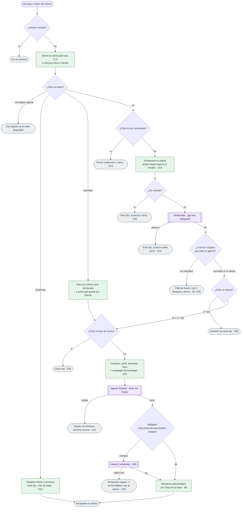

# Flujo del orquestador

Qué pasa con cada mensaje del cliente en `Orquestador.atender` (`src/agil/agente/orquestador.py`). En
verde, lo que decide el código sin LLM; en morado, donde interviene un modelo; en gris, las respuestas
fijas y los cierres.

Además: si el validador aprueba un texto que pide confirmar por escrito, se le pide al agente usar la
tarjeta (un reintento); si una tool cerró la sesión (handoff o no contactar), el turno termina con cierre.
El estratega no corre antes de verificar la cédula ni en el turno en que se verifica (retoma lo que el
cliente pidió).
